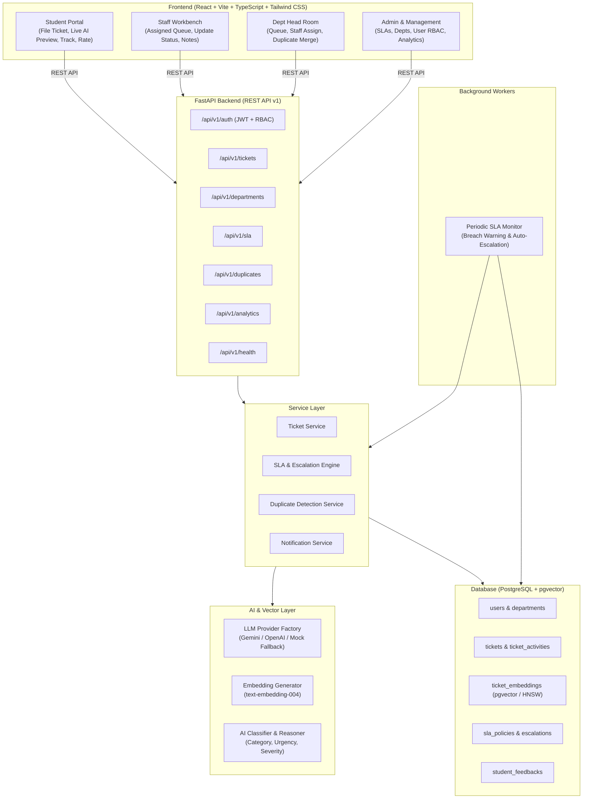
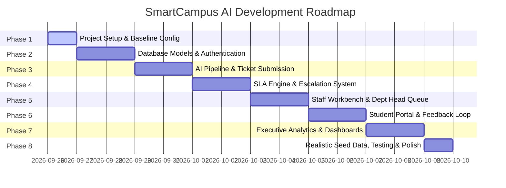

# SmartCampus AI — System Architecture Document
**Intelligent Campus Ticketing and Issue Resolution System**

## 1. Overview & Problem Statement
Modern educational campuses process hundreds of complaints across multiple infrastructure and administrative domains (hostel, network/IT, estate maintenance, sanitation, academics, transportation, canteen). Traditional ticketing portals suffer from:
1. **Misrouting & Department Confusion**: Students file tickets under wrong categories, delaying resolution.
2. **Duplicate Avalanche**: Recurring issues (e.g., hostel water shortage, Wi-Fi outage) generate dozens of duplicate tickets, overwhelming staff.
3. **Subjective Prioritization**: Critical safety issues get buried under trivial inquiries.
4. **Lack of SLA Accountability**: Tickets languish without automated tracking, breach warnings, or escalation.
5. **No Closed-Loop Feedback**: Students receive no transparent status updates and have no way to rate resolutions.

**SmartCampus AI** addresses these challenges through an end-to-end full-stack platform incorporating AI-driven categorization, vector-based duplicate detection, dynamic priority calculation, strict SLA tracking with automated escalation, and closed-loop feedback.

---

## 2. System Architecture Diagram



---

## 3. Proposed Folder Structure

```
campus-fix/
├── .env.example                     # Environment variables template
├── .gitignore                       # Git ignore configuration
├── docker-compose.yml               # Multi-container orchestration (DB, Backend, Frontend)
├── README.md                        # Documentation & quickstart guide
├── docs/                            # Documentation
│   └── architecture.md              # Full system architecture specification
│
├── backend/                         # FastAPI Python Backend
│   ├── .env.example                 # Backend environment variable template
│   ├── requirements.txt             # Python dependencies
│   ├── pyproject.toml               # Python project configuration
│   ├── Dockerfile                   # Backend Docker container specification
│   ├── alembic.ini                  # Alembic DB migration configuration
│   ├── alembic/                     # Database migrations
│   │   ├── env.py
│   │   └── versions/
│   └── app/
│       ├── __init__.py
│       ├── main.py                  # FastAPI application entry point, CORS, lifespan
│       ├── core/                    # Core configuration and security
│       │   ├── __init__.py
│       │   ├── config.py            # Pydantic Settings (env validation)
│       │   ├── database.py          # SQLAlchemy async session & engine setup
│       │   ├── security.py          # Password hashing (bcrypt) & JWT token utilities
│       │   ├── exceptions.py        # Custom domain and HTTP exception handlers
│       │   └── logging.py           # Structured application logging
│       ├── models/                  # SQLAlchemy ORM database models
│       │   ├── __init__.py
│       │   ├── base.py              # DeclarativeBase, UUIDPrimaryKey, TimestampMixin
│       │   ├── user.py              # User model & Role enum
│       │   ├── department.py        # Department & Category models
│       │   ├── ticket.py            # Ticket, TicketActivity, TicketAttachment
│       │   ├── sla.py               # SLAPolicy, EscalationLog
│       │   ├── duplicate.py         # TicketEmbedding, DuplicateCluster
│       │   └── feedback.py          # StudentFeedback model
│       ├── schemas/                 # Pydantic v2 validation models (DTOs)
│       │   ├── __init__.py
│       │   ├── auth.py              # Login, Token, TokenPayload
│       │   ├── user.py              # UserCreate, UserRead, UserUpdate
│       │   ├── department.py        # DepartmentCreate, CategoryCreate
│       │   ├── ticket.py            # TicketCreate, TicketRead, TicketUpdate, StatusChange
│       │   ├── sla.py               # SLAPolicyCreate, SLAPolicyRead, EscalationRead
│       │   ├── feedback.py          # FeedbackCreate, FeedbackRead
│       │   └── analytics.py         # AnalyticsSummary, DepartmentMetrics
│       ├── api/                     # API routers and dependencies
│       │   ├── __init__.py
│       │   ├── deps.py              # Dependency injection (Current User, Role Guards, DB Session)
│       │   └── v1/
│       │       ├── __init__.py
│       │       ├── api.py           # V1 API router aggregator
│       │       └── endpoints/
│       │           ├── __init__.py
│       │           ├── auth.py      # /api/v1/auth
│       │           ├── tickets.py   # /api/v1/tickets
│       │           ├── departments.py # /api/v1/departments
│       │           ├── duplicates.py  # /api/v1/duplicates
│       │           ├── sla.py       # /api/v1/sla
│       │           ├── feedback.py  # /api/v1/feedback
│       │           ├── analytics.py # /api/v1/analytics
│       │           └── health.py    # /api/v1/health
│       ├── services/                # Business logic services
│       │   ├── __init__.py
│       │   ├── ticket_service.py    # Ticket lifecycle orchestration
│       │   ├── sla_service.py       # SLA due date calculation and status updates
│       │   ├── escalation_service.py# Auto & manual escalation triggers
│       │   ├── duplicate_service.py # Vector similarity queries & clustering
│       │   └── notification_service.py # In-app notification dispatcher
│       ├── ai/                      # AI provider abstraction & prompt engine
│       │   ├── __init__.py
│       │   ├── base.py              # LLMProvider abstract base interface
│       │   ├── factory.py           # Provider factory (Gemini, OpenAI, MockFallback)
│       │   ├── gemini_provider.py   # Google Gemini LLM & embedding implementation
│       │   ├── embedding_service.py # Vector embedding generator
│       │   ├── classifier.py        # Complaint categorization & sentiment extraction
│       │   └── priority_engine.py   # Severity, urgency, and impact scoring
│       ├── workers/                 # Background tasks
│       │   ├── __init__.py
│       │   └── sla_monitor.py       # Periodic check for SLA countdowns & escalations
│       ├── seeds/                   # Realistic database seeders
│       │   ├── __init__.py
│       │   └── seed_data.py         # Seed realistic users, departments, tickets, SLA rules
│       └── tests/
│           ├── __init__.py
│           ├── conftest.py
│           ├── test_auth.py
│           ├── test_tickets.py
│           └── test_ai_pipeline.py
│
└── frontend/                        # React + Vite + TypeScript Frontend
    ├── .env.example
    ├── package.json
    ├── vite.config.ts
    ├── tsconfig.json
    ├── tailwind.config.js
    ├── postcss.config.js
    ├── index.html
    └── src/
        ├── main.tsx
        ├── App.tsx
        ├── index.css                # Design tokens, CSS variables, typography
        ├── assets/
        ├── components/              # Reusable UI & Layout components
        │   ├── ui/                  # UI primitives (Button, Card, Badge, Dialog, etc.)
        │   ├── common/              # StatusBadge, PriorityTag, SLACountdown, EmptyState, Loader
        │   ├── layout/              # Navbar, Sidebar, Topbar, RoleLayout
        │   └── feedback/            # Toast notifications, confirmation modals
        ├── contexts/                # React Contexts (AuthContext, ThemeContext)
        ├── hooks/                   # Custom React hooks (useAuth, useTickets, useSLA, useDebounce)
        ├── lib/                     # Utilities & API client
        │   ├── api.ts               # Axios instance with JWT interceptors
        │   ├── utils.ts             # Tailwind classnames merge (cn)
        │   └── constants.ts         # Enums, status colors, role mappings
        ├── pages/                   # Application Pages organized by Role
        │   ├── auth/                # Login, Register
        │   ├── student/             # Submit Complaint, My Tickets, Ticket Detail, Feedback
        │   ├── staff/               # Assigned Tickets, Work Queue, Resolution Modal
        │   ├── department/          # Dept Queue, Member Assignments, SLA At-Risk View
        │   ├── admin/               # System Overview, Departments, Users, SLA Config
        │   ├── management/          # High-level Analytics, SLA Compliance, Dept Reports
        │   └── shared/              # 404, Unauthorized, Profile
        ├── routes/                  # React Router configuration & RoleGuard
        │   ├── index.tsx
        │   └── ProtectedRoute.tsx
        └── types/                   # TypeScript interfaces
            ├── auth.ts
            ├── ticket.ts
            ├── department.ts
            └── analytics.ts
```

---

## 4. Database Architecture

### 4.1 Technology Choice & Rationale
- **Primary Database**: PostgreSQL 16+
- **Vector Search Extension**: `pgvector`
- **ORM**: SQLAlchemy 2.0 (with asyncpg / psycopg2)
- **Migration Tool**: Alembic
- **Fallback Compatibility**: SQLite connection fallback for environments without a running local PostgreSQL instance during rapid prototyping.

### 4.2 Entity Relationship (ER) Model

```mermaid
erDiagram
    USERS ||--o{ TICKETS : "creates (student)"
    USERS ||--o{ TICKETS : "assigned_to (staff)"
    DEPARTMENTS ||--o{ CATEGORIES : "has"
    DEPARTMENTS ||--o{ USERS : "employs (staff/head)"
    DEPARTMENTS ||--o{ TICKETS : "handles"
    CATEGORIES ||--o{ TICKETS : "categorizes"
    SLA_POLICIES ||--o{ TICKETS : "governs"
    TICKETS ||--o{ TICKET_ACTIVITIES : "logs"
    TICKETS ||--o| TICKET_EMBEDDINGS : "has_vector"
    TICKETS ||--o| STUDENT_FEEDBACKS : "rated_by"
    TICKETS ||--o{ TICKET_ATTACHMENTS : "includes"
    TICKETS ||--o{ ESCALATIONS : "triggers"
    TICKETS ||--o{ TICKETS : "parent_of_duplicates"

    USERS {
        uuid id PK
        string email UK
        string password_hash
        string full_name
        enum role "STUDENT|STAFF|DEPT_HEAD|ADMIN|MANAGEMENT"
        string phone
        uuid department_id FK "nullable"
        boolean is_active
        timestamp created_at
    }

    DEPARTMENTS {
        uuid id PK
        string name UK
        string code UK
        string description
        uuid head_id FK "nullable"
        boolean is_active
        timestamp created_at
    }

    CATEGORIES {
        uuid id PK
        uuid department_id FK
        string name
        string description
        enum default_priority "LOW|MEDIUM|HIGH|CRITICAL"
        int default_sla_hours
    }

    TICKETS {
        uuid id PK
        string ticket_number UK
        uuid student_id FK
        uuid department_id FK
        uuid category_id FK
        string title
        text description
        string location
        enum status "SUBMITTED|AI_PROCESSED|ASSIGNED|IN_PROGRESS|PENDING_INFO|RESOLVED|CLOSED|ESCALATED"
        enum priority "LOW|MEDIUM|HIGH|CRITICAL"
        float ai_category_confidence
        text ai_priority_explanation
        boolean is_duplicate
        uuid parent_ticket_id FK "nullable"
        float duplicate_similarity_score
        uuid assigned_staff_id FK "nullable"
        uuid sla_policy_id FK
        int sla_target_hours
        timestamp sla_due_at
        enum sla_status "ON_TRACK|AT_RISK|BREACHED|MET"
        timestamp resolved_at
        timestamp closed_at
        timestamp created_at
        timestamp updated_at
    }

    TICKET_EMBEDDINGS {
        uuid id PK
        uuid ticket_id FK UK
        vector embedding "768-dim"
        string content_hash
        timestamp created_at
    }

    SLA_POLICIES {
        uuid id PK
        string name
        enum priority "LOW|MEDIUM|HIGH|CRITICAL"
        int response_time_hours
        int resolution_time_hours
        int warning_threshold_percent "e.g. 75%"
        enum escalation_target_role "DEPT_HEAD|ADMIN"
        boolean is_active
    }

    ESCALATIONS {
        uuid id PK
        uuid ticket_id FK
        enum triggered_by "AUTO_SLA|MANUAL"
        text reason
        uuid previous_staff_id FK
        uuid escalated_to_id FK
        enum status "PENDING|ACKNOWLEDGED|RESOLVED"
        timestamp created_at
    }

    TICKET_ACTIVITIES {
        uuid id PK
        uuid ticket_id FK
        uuid actor_id FK
        enum action "CREATED|STATUS_CHANGED|ASSIGNED|ESCALATED|COMMENT_ADDED|RESOLVED|REOPENED"
        jsonb old_value
        jsonb new_value
        text note
        timestamp created_at
    }

    STUDENT_FEEDBACKS {
        uuid id PK
        uuid ticket_id FK UK
        uuid student_id FK
        int rating "1-5"
        enum satisfaction "VERY_SATISFIED|SATISFIED|NEUTRAL|DISSATISFIED"
        text comments
        timestamp created_at
    }

    TICKET_ATTACHMENTS {
        uuid id PK
        uuid ticket_id FK
        string file_name
        string file_url
        int file_size
        string mime_type
        uuid uploaded_by FK
        timestamp created_at
    }
```

### 4.3 Database Indexes & Optimization
1. **Full-Text & Relational Indexes**:
   - `CREATE INDEX idx_tickets_dept_status ON tickets(department_id, status);`
   - `CREATE INDEX idx_tickets_staff_status ON tickets(assigned_staff_id, status);`
   - `CREATE INDEX idx_tickets_student ON tickets(student_id);`
   - `CREATE INDEX idx_tickets_sla ON tickets(sla_status, sla_due_at);`
   - `CREATE UNIQUE INDEX idx_tickets_number ON tickets(ticket_number);`
2. **Vector Cosine Similarity Index (pgvector)**:
   - `CREATE INDEX idx_embeddings_hnsw ON ticket_embeddings USING hnsw (embedding vector_cosine_ops);`

---

## 5. Backend Architecture

### 5.1 Layered Architecture Pattern
1. **Controllers / API Endpoints (`app/api/v1/endpoints/`)**:
   - Request receipt and response serialization.
   - Pydantic v2 validation before passing to services.
   - Dependency injection for authentication (`get_current_user`), authorization (`require_roles`), and database session (`get_db`).
2. **Service Layer (`app/services/`)**:
   - Encapsulates pure business rules and transaction orchestration.
   - Never exposes ORM objects directly outside the service boundary without schemas.
   - Core services: `TicketService`, `SLAService`, `EscalationService`, `DuplicateService`, `AnalyticsService`.
3. **AI Layer (`app/ai/`)**:
   - Strategy and Factory pattern decoupling the application from specific AI providers.
   - Concrete implementations for Gemini API, OpenAI API, and a built-in deterministic Offline Mock Provider.
4. **Data Access Layer (`app/models/` & `app/core/database.py`)**:
   - SQLAlchemy 2.0 Async Session management with pooling.
   - Declarative Base with UUID primary keys and standard audit mixins.
5. **Background SLA Monitor (`app/workers/sla_monitor.py`)**:
   - Runs periodically (or triggered via worker/cron) to re-evaluate open tickets against `sla_due_at`.
   - Transitions tickets from `ON_TRACK` to `AT_RISK` when reaching 75% of target time.
   - Transitions to `BREACHED` and fires `EscalationService.trigger_escalation()` when `now() > sla_due_at`.

---

## 6. Frontend Architecture

### 6.1 Framework and Component Design
- **React 18/19 with Vite & TypeScript**: Strict type checking for all API payloads and component props.
- **Tailwind CSS + shadcn/ui**: Modern, accessible UI primitives with customized dark/light mode color tokens (Slate, Indigo, Emerald, Amber, Rose).
- **React Router v6**: Client-side routing with nested role-protected routes (`<RoleGuard allowedRoles={[...]} />`).
- **Recharts**: High-performance dashboard visualizations for SLA compliance, resolution time trends, and department distribution.

### 6.2 Application State & Data Flow
1. **Auth State (`AuthContext`)**:
   - Manages user session, JWT token storage in `localStorage`/`sessionStorage`, and user profile data.
   - Exposes `login()`, `logout()`, `hasRole()`, `isAuthenticated`.
2. **API Interceptor (`lib/api.ts`)**:
   - Automatically injects `Authorization: Bearer <token>` on all outgoing requests.
   - Intercepts `401 Unauthorized` responses to refresh the token or redirect to `/login`.
   - Returns structured error messages for toast notifications.
3. **Role-Based Portals**:
   - `/student`: Submit ticket with live AI duplicate detection warning, track complaints in a visual timeline, submit rating & feedback.
   - `/staff`: Dedicated work queue, sort by SLA urgency, quick status transitions with resolution evidence.
   - `/department`: Department overview, unassigned queue, manual re-assignment, duplicate merge review.
   - `/admin`: Role management, department & category configuration, SLA policy threshold editor.
   - `/management`: Executive analytics, cross-department SLA compliance benchmarks, heatmaps.

---

## 7. AI Architecture

### 7.1 Multi-Provider Abstraction
```
                  ┌───────────────────────────────┐
                  │    LLMProvider (Interface)    │
                  └───────────────▲───────────────┘
                                  │
         ┌────────────────────────┼────────────────────────┐
         │                        │                        │
┌─────────────────┐      ┌─────────────────┐      ┌─────────────────┐
│ GeminiProvider  │      │ OpenAIProvider  │      │  MockProvider   │
│ (Google Gemini) │      │   (GPT-4o)      │      │ (Offline/Rules) │
└─────────────────┘      └─────────────────┘      └─────────────────┘
```
The AI layer is configured via environment variables:
- `AI_PROVIDER`: `gemini` (default), `openai`, or `mock`.
- `AI_API_KEY`: API Key for chosen provider.
- `AI_MODEL_NAME`: e.g., `gemini-1.5-flash` or `gemini-2.0-flash`.
- `EMBEDDING_MODEL`: `text-embedding-004` (768 dimensions).

### 7.2 Core AI Workflows
1. **Intelligent Categorization & Priority Engine**:
   - **Input**: Complaint title, description, and physical campus location.
   - **Prompt**: System prompt enforcing strict JSON output conforming to:
     ```json
     {
       "department_code": "IT",
       "category_name": "Wi-Fi & Network Connectivity",
       "confidence": 0.94,
       "severity": 4,
       "urgency": 4,
       "priority": "HIGH",
       "reasoning": "Campus-wide library Wi-Fi outage during mid-term exam week affects critical student academic activities."
     }
     ```
   - **Severity (1-5)**: Assesses physical danger, financial loss, or academic impediment.
   - **Urgency (1-5)**: Assesses how quickly the situation will degrade without intervention.
   - **Calculated Priority Matrix**: Combines severity and urgency into `LOW`, `MEDIUM`, `HIGH`, or `CRITICAL`.

2. **Vector Duplicate Detection Pipeline**:
   - Step 1: When a ticket is submitted, create a composite text: `Title: {title} | Location: {location} | Description: {description}`.
   - Step 2: Generate a 768-dimensional dense vector embedding.
   - Step 3: Query the `ticket_embeddings` table using cosine distance (`1 - (embedding <=> query_vec)`).
   - Step 4: If top similarity score > **0.85**, mark as high-probability duplicate; notify the student with the parent ticket link and provide an option to "Upvote / Follow" instead of creating clutter.
   - Step 5: If similarity score is between **0.70 and 0.85**, flag as "Related Issue Candidate" in the Department Head workbench for 1-click merge.

3. **Resilience & Fallback Handling**:
   - If the external LLM provider encounters rate limits, network timeouts, or invalid keys, the `AIFactory` seamlessly falls back to the deterministic rule-based `MockProvider`, ensuring the ticketing system **never fails or crashes** for end users.

---

## 8. API Architecture

### 8.1 API Conventions
- **Prefix**: `/api/v1`
- **Format**: JSON payloads with standard envelope or direct schema.
- **Error Format**:
  ```json
  {
    "success": false,
    "error": {
      "code": "TICKET_NOT_FOUND",
      "message": "Ticket with ID '...' does not exist",
      "details": []
    }
  }
  ```
- **Documentation**: Interactive OpenAPI/Swagger documentation at `/docs` and ReDoc at `/redoc`.

### 8.2 Endpoints Roster
| Method | Endpoint | Description | Permitted Roles |
|---|---|---|---|
| `POST` | `/api/v1/auth/register` | Register a new user account | Public / Student |
| `POST` | `/api/v1/auth/login` | Login and receive JWT access/refresh token | Public |
| `GET` | `/api/v1/auth/me` | Fetch authenticated user profile & permissions | Any Authenticated |
| `POST` | `/api/v1/tickets` | Create a new ticket (triggers AI analysis & SLA) | Student, Admin |
| `GET` | `/api/v1/tickets` | List tickets (filtered by role, dept, status) | Any Authenticated |
| `GET` | `/api/v1/tickets/{id}` | Detailed ticket view with activity history & SLA | Any Authenticated (Subject to ownership/dept) |
| `PATCH` | `/api/v1/tickets/{id}/status` | Update ticket status (In Progress, Resolved, etc.) | Staff, Dept Head, Admin |
| `POST` | `/api/v1/tickets/{id}/assign` | Assign ticket to a staff member | Dept Head, Admin |
| `GET` | `/api/v1/tickets/{id}/duplicates`| View duplicate / related ticket candidates | Staff, Dept Head, Admin |
| `POST` | `/api/v1/tickets/{id}/merge` | Merge duplicate tickets into primary ticket | Dept Head, Admin |
| `POST` | `/api/v1/tickets/{id}/feedback` | Submit student satisfaction rating & comments | Student (Owner) |
| `GET` | `/api/v1/departments` | List all departments and categories | Any Authenticated |
| `POST` | `/api/v1/departments` | Create new department | Admin |
| `GET` | `/api/v1/sla/policies` | List SLA policies | Staff, Dept Head, Admin, Management |
| `GET` | `/api/v1/sla/at-risk` | List tickets at risk or breached | Dept Head, Admin, Management |
| `POST` | `/api/v1/sla/escalate` | Manually escalate a ticket | Staff, Dept Head, Admin |
| `GET` | `/api/v1/analytics/overview` | Overall campus KPI metrics | Admin, Management, Dept Head |
| `GET` | `/api/v1/analytics/trends` | Time-series resolution trends | Admin, Management, Dept Head |
| `GET` | `/api/v1/health` | Service health, DB connectivity, AI status | Public |

---

## 9. Authentication & Authorization Architecture

### 9.1 JWT Token Strategy
- **Access Token**: Short-lived (60 minutes), signed with `HS256`, containing:
  ```json
  {
    "sub": "user_uuid",
    "email": "student@campus.edu",
    "role": "STUDENT",
    "department_id": null,
    "exp": 1727330000
  }
  ```
- **Refresh Token**: Long-lived (7 days), stored securely to re-issue access tokens without re-entering credentials.
- **Password Security**: Passwords hashed using `bcrypt` (12 salt rounds).

### 9.2 Role-Based Access Control (RBAC) Matrix

| Feature / Action | Student | Staff | Department Head | Admin | Management |
|---|:---:|:---:|:---:|:---:|:---:|
| Submit Complaint |  |  |  |  |  |
| View Own Complaints |  |  |  |  |  |
| View Assigned Tickets |  |  |  |  |  |
| View All Department Tickets |  |  |  |  |  |
| Update Ticket Status |  |  |  |  |  |
| Assign Ticket to Staff |  |  |  |  |  |
| Merge Duplicate Tickets |  |  |  |  |  |
| Trigger Manual Escalation |  |  |  |  |  |
| Submit Resolution Feedback |  |  |  |  |  |
| Manage Users & Roles |  |  |  |  |  |
| Manage Departments & SLAs |  |  |  |  |  |
| View Executive Analytics |  |  |  |  |  |

---

## 10. Development Phases



- **Phase 1: Project Setup & Core Configuration** *(Current Step)*
  - Monorepo structure setup (`backend`, `frontend`, `docs`)
  - FastAPI baseline with Pydantic settings, DB connection engine, Base model, Alembic structure, and health endpoint
  - Vite React TypeScript frontend initialized with Tailwind CSS configuration and layout skeleton
  - Comprehensive documentation and environment templates
- **Phase 2: Database Models & Authentication (JWT + RBAC)**
  - Implement SQLAlchemy models (User, Department, Category, Ticket, SLA, Feedback)
  - JWT auth endpoints (`/login`, `/register`, `/me`), password hashing, and dependency injection guards
  - Frontend AuthContext, login/register views, and ProtectedRoute
- **Phase 3: AI Pipeline & Ticket Submission**
  - Implement LLM Provider factory (Gemini, OpenAI, MockFallback)
  - Implement categorization, priority scoring engine, and embedding generation
  - Integrate pgvector duplicate similarity detection
  - Student complaint submission UI with live duplicate warning
- **Phase 4: SLA Engine & Escalation System**
  - Implement SLA calculation logic and background countdown monitoring
  - Implement automatic escalation for at-risk and breached tickets
  - Department Head escalation dashboard and alert banners
- **Phase 5: Staff Workbench & Department Management**
  - Staff assignment queue, status workflow transitions (In Progress, Resolved)
  - Department Head ticket distribution and duplicate merge management
- **Phase 6: Student Portal & Closed-Loop Feedback**
  - Interactive complaint tracking with visual progress timeline
  - Star rating and satisfaction survey submission upon ticket resolution
- **Phase 7: Analytics & Executive Dashboards**
  - Implement analytics queries (SLA compliance rate, MTTR, category breakdown)
  - Recharts integration in frontend for executive & admin views
- **Phase 8: Realistic Seed Data, End-to-End Testing & Polish**
  - Realistic seed script populating 5 roles, 6 departments, 30+ tickets, and mock duplicates
  - Automated integration tests and Swagger documentation validation
